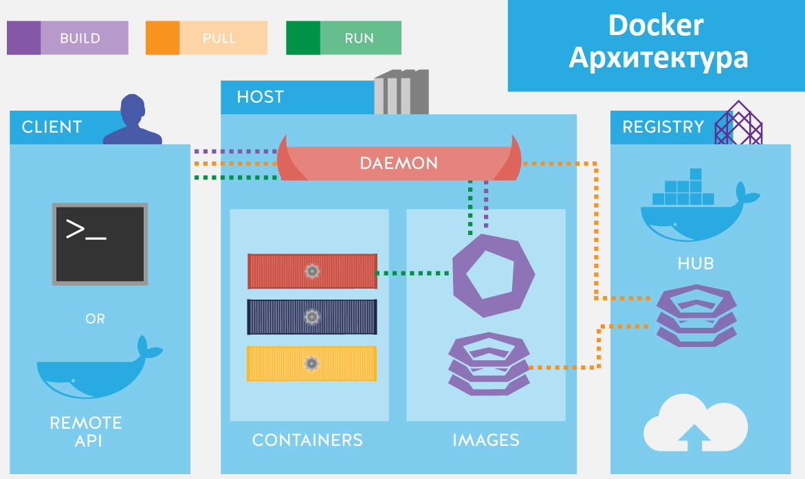

# :whale: Docker 

## :pushpin: Основные понятия:
| Docker | Это открытая платформа, которая позволяет автоматизировать развертывание, масштабирование и управление приложениями с помощью контейнеризации. Контейнеры Docker представляют собой легковесные и изолированные окружения, в которых можно запускать приложения и их зависимости. |
| :---: | :---: |
| **Docker контейнер** | Представляет собой экземпляр образа, который запускается и работает независимо от других контейнеров. Контейнеры изолированы от внешней среды и других контейнеров. |
| **Docker Образ (Docker Image)** | Представляет собой шаблоны или инструкции для создания контейнеров. |
| **Docker daemon (dockerd)** | Это основной компонент Docker, который отвечает за управление контейнерами и выполнение команд Docker. Он работает как фоновый процесс на хостовой операционной системе и прослушивает API запросы от Docker клиента. |
| **Docker (Client/CLI)** | Это интерфейс взаимодействия пользователя с Docker-демоном. |
| **Docker Hub/ Docker registry** | Это облачный репозиторий образов Docker, где разработчики могут делиться своими образами и использовать образы, созданные другими сообществами. Docker Hub также предоставляет функциональность для автоматической сборки и публикации образов из репозиториев кода, таких как GitHub. |
| **Пространства имен (Namespaces)** | Это механизм, который изолирует глобальные ресурсы операционной системы для каждого контейнера, создавая впечатление, что каждый контейнер имеет свою собственную изолированную среду. |
| **Dockerfile**        | Это текстовый файл, в котором определяется конфигурация образа Docker. В Dockerfile вы указываете инструкции для создания образа, такие как установка зависимостей, копирование файлов, настройка сети и другие операции. Затем Dockerfile используется для создания образа с помощью команды docker build. |
| **Docker Compose**    | Это инструмент для определения и управления многоконтейнерными приложениями. С помощью файла конфигурации YAML вы можете определить несколько контейнеров, их зависимости и настройки сети. Затем Docker Compose позволяет легко запускать и остановить все контейнеры одной командой. |
| **Bind Mounts**       | Это папка с файлами на локальном хосте, с которой контейнер может работать без ограничений. |
| **Volumes**           | Это папка с файлами на локальном хосте, которая управляется только докером (более строгий вариант). |
| **Storage driver**    | Это способ хранения образов и контейнеров на сервере. К примеру: AUFS, Overlay2, BTRFS, ZFS. |

## 📋 Архитектура:



## :dart: Чем Docker отличается от виртуальной машины (виртуалки):
**В целом, Docker предоставляет более легковесный и гибкий подход к развертыванию и управлению приложениями, в то время как виртуальные машины обеспечивают полную изоляцию и независимость операционных систем. Выбор между Docker и виртуалками зависит от конкретных требований вашего проекта.**
| Уровень изоляции | Виртуальные машины полностью эмулируют аппаратное обеспечение и каждая виртуальная машина имеет свою собственную операционную систему. Docker использует контейнеризацию, которая позволяет запускать приложения в изолированных контейнерах, но все контейнеры используют общую операционную систему хоста. Это делает контейнеры более легковесными и быстрыми в запуске по сравнению с виртуалками. |
| :---: | :---: |
| **Уровень изоляции** | Виртуальные машины полностью эмулируют аппаратное обеспечение и каждая виртуальная машина имеет свою собственную операционную систему. Docker использует контейнеризацию, которая позволяет запускать приложения в изолированных контейнерах, но все контейнеры используют общую операционную систему хоста. Это делает контейнеры более легковесными и быстрыми в запуске по сравнению с виртуалками. |
| **Ресурсы** | Виртуальные машины требуют выделения отдельных ресурсов, таких как память и процессорное время, для каждой виртуальной машины. Docker контейнеры используют общие ресурсы хоста, что делает их более эффективными в использовании ресурсов. |
| **Размер и скорость** | Виртуальные машины обычно занимают гигабайты дискового пространства и требуют значительного времени для запуска. Docker контейнеры, с другой стороны, могут быть гораздо меньше и запускаться практически мгновенно. |
| **Управление** | Docker предоставляет инструменты для управления контейнерами, такими как Docker CLI и Docker Compose. Виртуальные машины требуют отдельного управления каждой виртуальной машиной, например, с помощью гипервизора или оркестратора виртуальных машин. |
| **Портативность** | Docker контейнеры являются портативными и могут быть запущены на любой системе, поддерживающей Docker. Виртуальные машины, с другой стороны, требуют наличия гипервизора, который может быть разным для разных операционных систем. |


## :computer: Инструкция по установке Docker на Linux:
```ruby
$ apt-get update                       # Обновляемся
$ apt-get install apt-transport-https  # Устанавливаем https протокол
$ curl -fsSL https://download.docker.com/linux/ubuntu/gpg | sudo apt-key add  # Добавить ключ
$ add-apt-repository "deb [arch=amd64] https://download.docker.com/linux/ubuntu $(lsb_release -cs) stable"  # Актуализировать версию
$ apt-get update                 # Ещё раз обновляемся
$ apt-get install docker-ce      # Устанавливаем docker
$ systemctl status docker        # Проверяем процесс докера
$ sudo usermod -aG docker $USER  # Можно добавить юзера, как рута (optional)
$ getent group docker            # Посмотреть пользаков в группе docker

# Включение службы
$ sudo systemctl enable docker --now
$ systemctl status docker
$ docker info                    # Проверка работы Docker
```


## :computer: Дополнительная информация:
```ruby
$ cat /etc/docker/daemon.json           # Файл с реестрами
$ docker info | grep "Docker Root Dir"  # Посмотреть в какую директорию скачиваются образы docker
Вывод:
Docker Root Dir: /opt/minio/docker-data

# Перемещение docker (для того, чтобы хватало места для образов)
$ systemctl stop docker
$ mv /var/lib/docker /opt/taxmon/docker
$ ln -s /opt/taxmon/docker /var/lib/docker
$ systemctl start docker

# Если не проставилась инфа в REPOSITORY и TAG, можно сделать вручную
$ docker tag 49bfe3d5e57e rtknm:back-svk
$ docker rmi repository:back-svk  # Удалить дубль образа с одинаковыми ID
```


## :green_book: Основные команды для работы с контейнерами:
```ruby
$ docker run {IMAGE_NAME}         # Запустить/скачать docker контейнер на основе определенного образа
$ docker run --name {CONTAINER_NAME} {IMAGE_NAME}:{IMAGE_TAG}  # Запуск контейнера со своим именем
$ docker run -v c:\localhost\path:/docker/path {IMAGE_NAME}    # Монтировать папку в контейнер с локального хоста 
$ docker run -d -p 8080:80 nginx  # Создание и запуск контейнера из образа в фоновом режиме (-d detach) и пробросом порта 8080 на localhost
$ docker run -it -p 8080 nginx    # Запустить контейнер it(интерактивно в консоли), p(порт веб-сервера 8080)
http://192.168.197.128:8080/      # Идём тестить в браузер (ip вставляем ваш)
$ docker ps                       # Показать только запущенне контейнеры
$ docker ps -a                    # Показать все контейнеры
$ docker ps -s                    # Показать все контейнеры и их обьём
$ docker ps --format "table {{.ID}}\t{{.Image}}\t{{.Status}}\t{{.Ports}}"  # Вывести красиво все контейнеры
$ docker start {CONTAINER_ID}     # Запустить контейнер
$ docker start -a {CONTAINER_ID}  # Запустить контейнер и сразу смотреть по нему логи
$ docker stop {CONTAINER_ID}      # Остановка запущенного контейнера
$ docker stop $(docker ps -a -q)  # Остановить все контейнеры
$ docker kill {CONTAINER_ID}      # Резко остановить контейнер
$ docker rm {CONTAINER_ID}        # Удалить контейнер (перезапустить его)
$ docker rm -f {CONTAINER_ID}     # Удалить контейнер с принудительной остановкой его
$ docker container prune          # Удалить все контейнеры, которые остановлены
$ docker restart {CONTAINER_ID}   # Перезапустить контейнер
$ docker logs {CONTAINER_ID}      # Посмотреть логи контейнера
$ docker logs -f {CONTAINER_ID}   # Посмотреть логи контейнера и отображать их в режиме реального времени
$ docker inspect {CONTAINER_ID}   # Посмотреть подробную информацию о контейнере
$ docker pause {CONTAINER_ID}     # Остановить выполнение контейнера
$ docker unpause {CONTAINER_ID}   # Восстановить выполнение контейнера
$ docker attach {CONTAINER_ID}    # Присоединение к запущенному контейнеру и взаимодействие с ним
$ docker top {CONTAINER_ID}       # Посмотреть процессы, выполняющиеся внутри контейнера
$ docker stats {CONTAINER_ID}     # Посмотреть статистику использования ресурсов контейнера
$ docker-compose up               # Управление множеством контейнеров с помощью файла docker-compose.yml
$ docker exec -it {CONTAINER_ID} command   # Выполнить команду внутри запущенного контейнера (например sh, bash, psql, etc)
$ docker rename {CONTAINER_ID} {NEW_NAME}  # Переименовать контейнер
$ docker update --cpus 2 {CONTAINER_ID}    # Обновить настройки контейнера во время его выполнения
$ docker cp {CONTAINER_ID}:/path/to/file /host/path  # Копировать файлы между контейнером и хостовой машиной
$ docker cp /host/path {CONTAINER_ID}:/path/to/file  # Копировать файлы между хостовой машиной и контейнером
```


## :blue_book: Основные команды для работы с образами:
```ruby
$ docker run {IMAGE_NAME}                            # Запустить/скачать docker контейнер на основе определенного образа
$ docker images                                      # Показать образы, которые есть на машине
$ docker image ls --no-trunc                         # Показать образы не сокращая их айди (sha256)
$ docker search {IMAGE_NAME}                         # Произвести поиск образа в консоли по Docker-Hub
$ docker pull   {IMAGE_NAME}                         # Скачать образ (по умолчанию latest - последюю версию)
$ docker pull   {IMAGE_NAME} {IMAGE_TAG}             # Скачать образ указывая его конкретную версию
$ docker push   {IMAGE_NAME}                         # Загрузить образ в Docker-Hub (Либо $ docker push username/repository:tag)
$ docker rmi    {IMAGE_NAME}                         # Удалить образ
$ docker build -t {name_image}:{tag_image}           # Создать образ с указанием тэга
$ docker build -t {IMAGE_NAME} {path-to-dockerfile}  # Создать образ из Dockerfile (./path/to/dockerfile)
$ docker tag image_id new_image_name:new_tag         # Присвоение тега (метки) Docker образу
$ docker save -o image.tar image_id                  # Сохранение Docker образа в архивный файл
$ docker load -i image.tar                           # Загрузка образа Docker из архивного файла
$ docker history {IMAGE_NAME}                        # Посмотреть историю слоев Docker образа
$ docker inspect {IMAGE_NAME}                        # Посмотреть подробную информацию об образе
```

## :chart_with_upwards_trend: Основные команды для работы с сетью:
```ruby
$ docker network ls                                          # Посмотреть сети подключения докера
$ lsof -i -P -n  | grep docker                               # Посмотреть открытые порты докера
$ docker network create {NETWORK_NAME}                       # Создание новой сети Docker
$ docker network inspect {NETWORK_ID}                        # Получение подробной информации о сети Docker
$ docker network connect {NETWORK_ID} {CONTAINER_ID}         # Подключение контейнера к сети Docker
$ docker network disconnect {NETWORK_ID} {CONTAINER_ID}      # Отключение контейнера от сети Docker
$ docker network rm {NETWORK_ID}                             # Удаление сети Docker
$ docker network prune                                       # Удаление неиспользуемых сетей Docker
$ docker run --network {NETWORK_ID} {IMAGE_NAME}             # Запуск контейнера с присоединением к определенной сети Docker
$ docker network create --driver bridge {NETWORK_NAME}       # Создание сети Docker с определенным драйвером
$ docker network inspect --format '{{.Name}}' {NETWORK_ID}   # Получение определенной информации о сети Docker в определенном формате
```


## :computer: Полная установка docker compose на Linux:
```ruby
$ apt-get update
$ apt-get install docker-compose-plugin
$ apt-get install ca-certificates curl gnupg
$ mkdir -p /etc/apt/keyrings
$ curl -fsSL https://download.docker.com/linux/ubuntu/gpg | sudo gpg --dearmor -o /etc/apt/keyrings/docker.gpg
$ echo \
  "deb [arch=$(dpkg --print-architecture) signed-by=/etc/apt/keyrings/docker.gpg] https://download.docker.com/linux/ubuntu \
  $(lsb_release -cs) stable" | sudo tee /etc/apt/sources.list.d/docker.list > /dev/null
$ apt-get update
$ apt-get install docker-ce docker-ce-cli containerd.io docker-compose-plugin
$ docker --version
$ docker compose version
```


## 📑 Основные команды для работы с Docker Compose:
```ruby
$ docker compose version                  # Посмотреть версию docker compose
$ docker compose pull                     # Скачать все образы, которые указаны в docker-compose.yml
$ docker compose push                     # Скачать образ из локально реестра в удаленный реестр (Docker Registry)
$ docker compose up -d                    # Запуск контейнеров из docker-compose.yml
$ docker compose down                     # Остановка всех контейнеров
$ docker compose ps                       # Посмотреть список активных контейнеров данного docker-compose.yml
$ docker compose logs -f {name_services}  # Просмотр логов
$ docker compose top                      # Посмотреть какие процессы запущены в контейнерах и от каких пользаков, и когда
```


## :scroll: Пример Dockerfile:
```dockerfile
# Используем базовый образ Ubuntu
FROM {name_container}:{version_container}  # Пример: FROM ubuntu:latest

# Устанавливаем необходимые пакеты
RUN apt-get update && apt-get install -y \
    python3 \
    python3-pip

# Копируем файлы в контейнер
COPY {config.cfg} /{work_directory}  # Пример: COPY . /app

# Устанавливаем зависимости
RUN pip3 install -r /app/requirements.txt

# Определяем рабочую директорию
WORKDIR /app

# Определяем команду, которая будет выполняться при запуске контейнера
CMD ["python3", "app.py"]
```

`docker build -t my-app .` - Собираем Docker образ

`docker run -d -p 8080:8080 my-app` - Запускаем контейнер

Теперь приложение будет доступно по адресу http://localhost:8080


## :scroll: Пример docker-compose.yml файла:
```yml
version: '3'

# Секция общих настроек логирования
x-logging: &logging
  driver: "json-file"  # Использовать драйвер json-file для логов
  options:
    max-size: "1m"     # Максимальный размер одного лог-файла
    max-file: "1"      # Максимальное количество файлов логов

# Другой шаблон логирования (30MB файлы)
x-logging-30: &logging-30
  driver: "json-file"
  options:
    max-size: "30m"
    max-file: "3"

# Определение сетей
networks:
  shared-net:
    external: true     # Использовать внешнюю сеть (уже созданную)

# Секция сервисов (контейнеров)
services:
  audit-service:
    restart: always            # Автоматический перезапуск при падении
    image: registry.ru/{service_name}:{version}  # Образ из приватного реестра
    hostname: {service_name}              # Имя хоста внутри контейнера
    command: /opt/application/service.sh  # Команда запуска
    working_dir: /opt/application         # Рабочая директория
    environment:              # Переменные окружения
      CONFIG: service.config  # Конфигурационный файл
    extra_hosts:              # Дополнительные записи в /etc/hosts
      postgres: "{IP_HOST_POSTGRES}"
    networks:
      - shared-net            # Подключение к общей сети
    logging: *logging         # Использование шаблона логирования

# FRONT через Dockerfile
  front:
    restart: always
    build:                    # Сборка образа из Dockerfile
      context: ./nginx        # Контекст сборки
      dockerfile: Dockerfile  # Имя Dockerfile
    hostname: front
    ports:                    # Проброс портов (хост:контейнер)
      - 80:8080               # HTTP
      - 443:443               # HTTPS
    networks:
      - shared-net
    depends_on:               # Зависимости (запускать после этих сервисов)
      - back
      - conversations
    volumes:                  # Монтирование томов
      - ./nginx/ssl:/etc/nginx/ssl/  # SSL сертификаты
    command: nginx -g 'daemon off;'  # Запуск nginx в foreground режиме
    logging: *logging

# KAFKA стек
  zookeeper:                        # Сервис координации для Kafka
    container_name: zookeeper
    restart: always
    image: bitnami/zookeeper:3.8.1  # Официальный образ от Bitnami
    hostname: zookeeper
    environment:
      ZOOKEEPER_CLIENT_PORT: 2181   # Порт для клиентов
      ZOOKEEPER_TICK_TIME: 2000     # Тиковое время
      ALLOW_ANONYMOUS_LOGIN: 'yes'  # Разрешить анонимный доступ
    ports:
      - 2181                        # Экспорт порта (без маппинга на хост)
    networks:
      - shared-net
    logging: *logging

  kafka:                            # Брокер сообщений Kafka
    container_name: kafka
    restart: always
    image: bitnami/kafka:3.4.0
    depends_on:                     # Зависит от zookeeper
      - zookeeper
    hostname: kafka
    environment:                    # Конфигурация Kafka
      KAFKA_CFG_NODE_ID: 1          # ID ноды
      KAFKA_CFG_ZOOKEEPER_CONNECT: zookeeper:2181  # Подключение к Zookeeper
    volumes:
      - "kafka_data:/bitnami"       # Том для данных Kafka
    ports:
      - 9092:9092                   # Маппинг порта Kafka на хост
    networks:
      - shared-net
    logging: *logging

  schema-registry:            # Реестр схем для Kafka
    container_name: schema-registry
    restart: always
    image: bitnami/schema-registry:7.1
    hostname: schema-registry
    depends_on:
      - kafka
    volumes:
      - ./schema-registry:/bitnami/schema-registry  # Монтирование конфигов
    ports:
      - 8083:8081                                   # Маппинг порта (хост:контейнер)
    environment:
      SCHEMA_REGISTRY_ADVERTISED_HOSTNAME: schema-registry
      SCHEMA_REGISTRY_KAFKA_BROKERS: 'PLAINTEXT://kafka:9092'
      SCHEMA_REGISTRY_LISTENERS: http://schema-registry:8081
    networks:
      - shared-net
    logging: *logging

  kafka-ui:                   # Веб-интерфейс для администрирования Kafka
    image: kafka-ui:latest
    container_name: kafka-ui
    ports:
      - "8080:8080"           # Веб-интерфейс доступен на порту 8080
    environment:
      KAFKA_CLUSTERS_0_NAME: "local"                   # Имя кластера
      KAFKA_CLUSTERS_0_BOOTSTRAPSERVERS: "kafka:9092"  # Адрес брокера
      KAFKA_CLUSTERS_0_ZOOKEEPER: "zookeeper:2181"     # Адрес Zookeeper
    networks:
      - shared-net
    depends_on:
      - kafka
      - zookeeper
    restart: unless-stopped   # Перезапуск, если не остановлен вручную

  minio:                      # S3-совместимое объектное хранилище
    container_name: minio
    restart: always
    image: registry.ru/miniodata:{version}  # Кастомный образ
    hostname: minio
    environment:
      MINIO_ROOT_USER: {admin}              # Администратор
      MINIO_ROOT_PASSWORD: {MINIO_ROOT_PASSWORD}  # Пароль
      MINIO_SKIP_CLIENT: "yes"
      BITNAMI_DEBUG: "true"
    ports:
     - 9000:9000              # API порт
     - 9001:9001              # Консоль администрирования
    networks:
      - shared-net
    volumes:
      - /opt/minio/minio-data:/data  # Монтирование директории для данных
    logging: *logging

  redis:                      # Кэш-хранилище Redis
    container_name: redis
    image: redis:6            # Официальный образ Redis 6
    hostname: redis
    restart: always
    networks:
      - shared-net
    logging: *logging

# Глобальные определения сетей и томов
networks:
  shared-net:
    external: true            # Сеть должна быть создана заранее

volumes:
  kafka_data:                # Именованный том для данных Kafka
    driver: local            # Использовать локальный драйвер
```


## 📚 Docker Swarm:
`Docker Swarm` — это система оркестрации для Docker, которая превращает набор Docker-хостов в полноценный кластер, называемый Docker Swarm

```ruby
1. 'Динамическое управление ролями: /manager worker'
Чтобы динамически добавить/убрать роль manager нужно выполнить команду:
$ docker node promote {node_name}  # Добавление роли manager
$ docker node demote {node_name}   # Удаление роли manager

2. 'Динамическое масштабирование сервисов'
$ docker service update =3 my-service  # Добавление реплик сервиса
$ docker service rollback my-service   # Откат изменений (отмена последнего изменения конфигурации)

3. 'Инициализация кластера'
$ docker swarm init --advertise-addr {ip_address>}

4. 'Вывод актуальных ключей для добавления нод в кластер'
$ docker swarm join --token
$ docker swarm join-token -q worker
$ docker swarm join-token -q manager

5. 'Просмотр и обновление сертификатов кластера'
$ docker swarm ca
$ docker swarm ca --rotate

6. 'Удаление ноды из кластера'
$ docker swarm leave

7. 'Очистка ноды Docker Swarm перед удалением из кластера'
$ docker node update --availability drain node01

8. 'docker node — набор команд для управления свойствами, ролями, атрибутами нод Docker Swarm кластера'
Доступны команды: ls, promote, demote, inspect, ps, rm, update
$ docker node promote node02 node03  # Добавление роли manager для 2 нод Docker Swarm в работающем кластере
$ docker node demote node02 node03   # Удаление роли manager для 2 нод Docker Swarm в работающем кластере

9. 'docker service — набор команд для управления сервисами и их свойствами, работающими в кластере Docker Swarm'
Доступны команды: create, inspect, logs, ps, ls, rollback, rm, scale, update
$ docker service create --name web --replicas 3 --replicas-max-per-node 1 --constraint node.platform.linux==linux nginx:alpine  # Добавление сервиса nginx в количестве 3 реплик и определение критериев для целевых нод
$ docker service ls  # Просмотр статуса сервиса
Вывод:
'
ID NAME MODE REPLICAS IMAGE PORTS
b6lww17hrr4e web replicated 3/3 nginx:alpine
'
$ docker service rm {ID_SERVICE}  # Удаление сервиса

10. 'docker stack — набор команд для управления сервисами и их свойствами в формате идентичном Docker Compose, но для кластера Docker Swarm'
Доступны команды: deploy, ls, ps, rm, services

$ docker stack deploy --compose-file docker-compose.yml nginx   # Деплой сервиса nginx с использованием конфигурационного Compose файла
$ docker stack rm netology
$ docker swarm init --advertise-addr 10.128.0.28                # Инициализация кластера docker swarm
Вывод:
docker swarm join --token SWMTKN-1-5******* 10.128.0.28:2377
$ docker swarm join --token SWMTKN-1-5******* 10.128.0.28:2377  # Добавление воркеров [Делаем на первом воркере]
$ docker swarm join --token SWMTKN-1-5******* 10.128.0.28:2377  # Делаем на втором воркере
$ docker node ls                                                # Посмотреть состав кластера
$ docker swarm init --advertise-addr {IP}                       # Инициализация нового Docker Swarm кластера из Docker-нод
```


